# 38 条消息，让 GPT-6 Astra 复刻莱茵生命 UI：完整制作流程

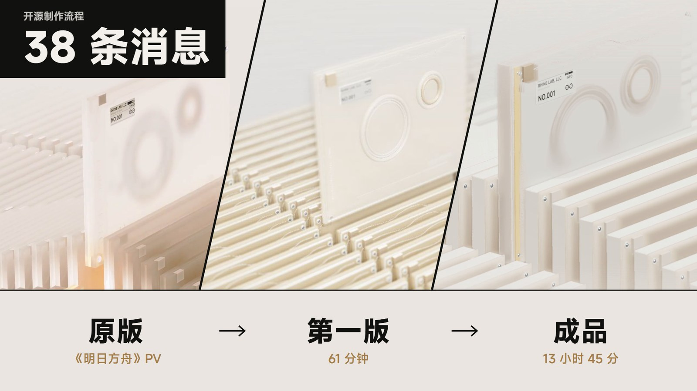

> 作者：路北路陈 LBLC
> 配套视频：【开源制作流程】38 条消息，让 GPT-6 Astra 复刻出 20w 人看过的莱茵生命 UI
> 项目仓库：<https://github.com/LBEILC/RhineLabUI>（本文说的"第一版"是提交 `df7da0f`）
>
> 这份文档把我和 Codex 之间的 38 条消息逐条摊开，写清楚每一条说了什么、Codex 做了什么、我为什么这么说。原话都是语音输入，基本保留原样，个别错字在〔〕里订正。时间一律是北京时间。
>
> **先说在前面：流程并非固定，需要根据模型输出动态调整。** 下面的顺序是这一次的实际情况，不是模板。下一次换一个项目、换一个模型，Codex 在哪里卡住都会不一样，要看它交出来的东西再决定下一句说什么。

---

## 目录

1. [结论：五条方法](#1-结论五条方法)
2. [项目和数据](#2-项目和数据)
3. [第一条提示词](#3-第一条提示词)
4. [逐条复盘](#4-逐条复盘)
   - [第一幕：起步（#1）](#第一幕起步1)
   - [第二幕：逼近原片（#2–#10）](#第二幕逼近原片2-10)
   - [第三幕：从复刻到系统（#11–#22）](#第三幕从复刻到系统11-22)
   - [第四幕：实验和回退（#23–#37）](#第四幕实验和回退23-37)
   - [第五幕：交付（#27、#28、#35、#38）](#第五幕交付27283538)
5. [反馈怎么沉淀成规则](#5-反馈怎么沉淀成规则)
6. [第二天的复盘：观察和解释](#6-第二天的复盘观察和解释)
7. [可以直接套用的反馈句式](#7-可以直接套用的反馈句式)
8. [踩过的坑](#8-踩过的坑)
9. [附录](#9-附录)

---

## 1. 结论：五条方法

| 方法 | 一句话 | 在哪几条消息里 |
|---|---|---|
| **提示词写标准，不写做法** | 交代参考范围、验收标准、硬约束和理由，技术路线交给模型 | #1 |
| **反馈说现象；归因错了，当场纠正** | 说"我看到了什么不对"，不说"你去改哪个参数"；它改对了症状、改错了原因，立刻指出来 | #2、#3、#5 |
| **看不清的，就画出来、报帧号** | 把"感觉不对"变成可以测量的东西：手绘标注、具体帧号、加上我对原理的理解 | #6、#8 |
| **满意了就冻结方向，先存基线** | 说出"大方向不用动了"，并要求改之前先存档；修复放在分支上，确认后再合并 | #11、#15、#16、#17 |
| **看不出区别就做对比；效果不好，就回退** | 让它做同步对比页；试完几个方案都不如原来，就明确回到基线 | #23–#31 |

整件事的核心只有一句：**好结果不是一条完美的提示词写出来的，而是一轮一轮反馈出来的。每次反馈，都是把"看起来不对"变成模型能测量、能验证的约束。**

---

## 2. 项目和数据

### 做的是什么

照着《明日方舟》特别映像《莱茵生命：访问》第 5–40 秒，用网页复刻里面的档案系统界面：白场开机动画、三维档案阵列、卡片抽取和镜头运动。再补上原片里没有的交互，让它变成一个能真正操作的系统。

- 工具：Codex（模型 GPT-6 Astra），使用 Codex 自带的浏览器看页面，通过 Blender MCP 制作三维模型。
- 最终技术栈：TypeScript、Three.js、Vite（Codex 自己选的）。

### 关键数据

| 项目 | 数值 | 说明 |
|---|---|---|
| 起止 | 09-07 21:48 → 09-08 11:33 | 第一条提示词到 `df7da0f`，共 13 小时 45 分 |
| 睡觉 | 约 5.5 小时 | 02:14 → 07:54 |
| 消息数 | 38 条 | 去掉了一条被中断后重发的重复消息；其中 2 条是回答 Codex 的提问 |
| 第一版（v0）用时 | 61 分钟 | 21:48 → 22:49 |
| 上下文压缩 | 开发主线程 8 次 | 会话记录里的压缩事件 |
| Token | 约 1.57 亿，95.6% 是缓存输入 | 按 API 标准价折算约 223 美元，不等于订阅账单；统计截至 09-08 14:39，包含 `df7da0f` 之后的 README 和许可证整理 |
| 并行窗口 | 2 个 | 开发主线程，加一个专门录演示视频的窗口 |

### 时间线总览

| 阶段 | 时间 | 消息 | 发生了什么 |
|---|---|---|---|
| 起步 | 21:48–22:49 | #1 | 一条提示词，61 分钟交出 v0 |
| 逼近原片 | 22:50–01:53 | #2–#10 | 说现象、列清单、纠正归因、画标注、报帧号，v1 → v4 |
| 冻结方向 | 01:58–02:26 | #11–#16 | "大方向不用动了"，建 Git 仓库、打基线、修复放分支 |
| 睡觉 | 02:26–07:54 | — | — |
| 加功能 | 07:54–08:47 | #17–#22 | 合并修复，加 360° 查看、拆解重组、循环阵列 |
| 实验和回退 | 08:51–09:39 | #23–#26、#29–#31 | 三个动效方案都不如基线，回退 |
| 打磨 | 09:40–10:31 | #32–#34、#36–#37 | 滚动数字、黑条过渡、360° 进出过渡、2D 开场逐帧打磨 |
| 交付 | 09:08–11:33 | #27、#28、#35、#38 | 另一个窗口录 4K60 演示视频、准备投稿、整理开源，`df7da0f` |

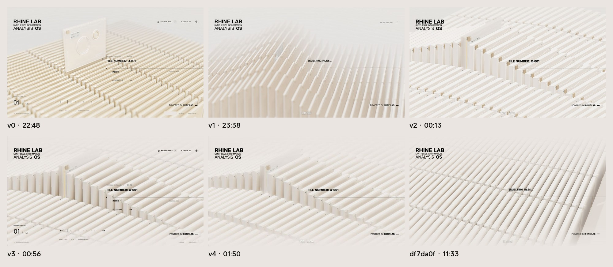

> 上图是 v0 到 v4 每一轮交付前后 Codex 自己截的检查截图。当时还没有 Git，这些截图是这几版唯一留下来的画面。

---

## 3. 第一条提示词

**#1 · 09-07 21:48**

> 参考工作目录的UI 像素级复刻一个系统 系统整体设计 和动效水平 参考视频5-40s 注意 需要美术资源自己调用blendermcp完成 要像素级复刻 不使用前端skill 因为这个和一般网页不一样 你自己选择合适技术栈实现 自行补充视频没有展示到的相关交互 品质要对齐视频

这条提示词没有教 Codex 怎么做，只交代了六件事：

| 类别 | 原文 | 作用 |
|---|---|---|
| 参考范围 | 参考视频5-40s | 圈定要对齐的片段，不让它自己挑 |
| 验收标准 | 像素级复刻 / 品质要对齐视频 | 给出一个很高、而且能对着原片检查的标准 |
| 管线约束 | 需要美术资源自己调用blendermcp完成 | 硬约束：模型必须自己建，不许拿图片糊弄 |
| 排除项和理由 | 不使用前端skill 因为这个和一般网页不一样 | 说"不要什么"的同时说清楚"为什么"，它才不会在别处绕回来 |
| 放权 | 你自己选择合适技术栈实现 | 技术路线交给它，我不替它做工程决定 |
| 留白 | 自行补充视频没有展示到的相关交互 | 告诉它原片不是全部，缺的部分它可以主动补 |

**Codex 的做法：** 先把视频每两秒截一帧，铺成总览来看，再搭三维场景。61 分钟后交出 v0：启动认证、圆环扫描、三维档案阵列、抽取镜头，还补了检索、详情、收藏、导出、设置和键盘交互。它自己在最后写了一句：

> 当前玻璃折射、景深和运镜仍与原片有差异，尚不能称为严格逐像素一致。

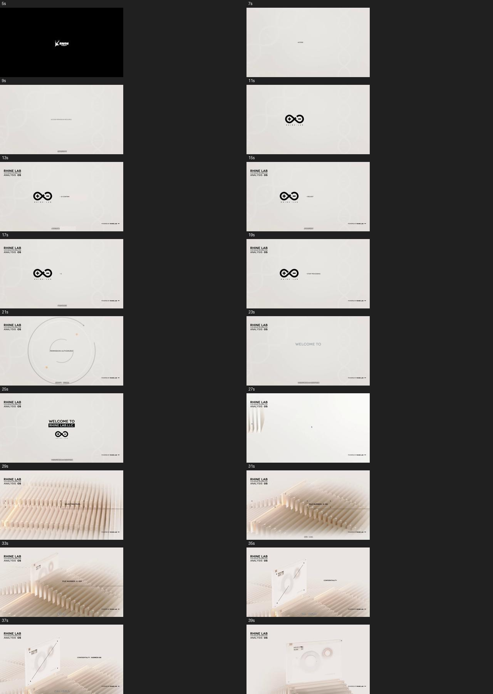

**我的判断：** 它知道有差距，但不知道差距有多大。接下来所有反馈要解决的，就是"差距有多大、差在哪里"。

---

## 4. 逐条复盘

每条的格式：**原话** → **Codex 做了什么** → **这条在做什么**。

### 第一幕：起步（#1）

见上一节。

### 第二幕：逼近原片（#2–#10）

#### #2 · 22:50 · 说现象

> 看你现在做的这个，和我视频里面是一个东西吗？你看看差距有多大，它整体的交互自然程度和你这个完全不是一个级别的。
>
> 你可以逐帧看一下，判断一下它的运动轨迹。它明显有一个像波纹一样的整体移动效果，但是你完全没有实现出来。
>
> 你再看你这个单个东西的材质效果，和它也是完全没得比啊，效果差距非常大。你再仔细打磨一下。

**Codex 做了什么（23:42 交付 v1）：** 重做了核心三维部分：整列波峰传播、反向回落、两段抽取；重排镜头轨迹；在 Blender 里重建磨砂外壳、内部圆环和刻线。它还自己做了一个和原片**同步逐帧对照**的页面，之后很多轮都在这个页面上比较。

**这条在做什么：**
- 语气很冲，但信息都是**现象**："像波纹一样的整体移动""材质差距大"。我没说用什么算法、改哪个参数。
- 给了**方法**："逐帧看一下，判断一下运动轨迹"。
- 结果下一版，波纹就出来了。

#### #3 · 23:44 · 五条清单，每条附判断方法

> 是比上一个版本要好，但是整体还有很大差距，感觉你还要继续打磨：
>
> 1. 字体样式：整体字体的样式我也不知道他用的什么字体，如果你不知道的话，你可以用 misans。
> 2. 摄像机视角：很多地方连摄像机的视角都完全不一样，你自己对比看一下 没事，就包括这个地方，你看他原视频到底展示了几列？现在到底展示了几列？你自己对比一下，是不是差距确实还是很大。
> 3. 逐帧复刻细节：你没有发现最后选出来这几帧之前，波浪滚回来之后，被选中的这一张左右两边还是有一点起伏的。都说了让你逐帧复刻，对吧？你自己再看看。
> 4. 卡片间距：卡片的宽度和它的间隙，我觉得你也没有完全复刻出来。
> 5. 整体光照：整体的光照也是你说的，这些都还差距很大。

**这条在做什么：**
- 先肯定进步，再列问题，一次列全。
- 每条都尽量带上**它能自己验证的方法**：比如"原视频展示了几列？现在几列？自己对比"。这比说"视角不对"有用得多，因为数列数是它能做到、而且能对错分明的事。
- 字体给了兜底方案（不知道就用 MiSans），避免它在一个找不到答案的问题上卡住。

#### #4 · 23:47 · 补一条遗漏

> 从这个白色的界面切换到这个卡片的界面，整个过渡你也没做出来，这个地方也需要改进

**这条在做什么：** 发现漏说的，马上补一条，不等下一轮。

#### #5 · 00:02 · 纠正归因

> 这个是间距的问题吗？你再仔细看看呢。我觉得不是间距的问题啊，单纯是这个摄像机的问题啊

**背景：** Codex 看到"列数不对"之后，去改了卡片间距，把列数硬凑对了。列数确实对了，但透视还是不对。原片是长焦：镜头远、视角窄，一屏能看到很多列，透视很平；Codex 的镜头近、视角宽，只挤间距能凑出列数，透视却还是陡的。

**Codex 做了什么（00:32 交付 v2）：**

> 你说得对，主要是摄像机校准有误。我已撤回用间距补偿列数的改动，重新调整视角、取景范围和转动时机。

同时补上了白场入场、选中卡片两侧的余波，接入了 MiSans，调了光照。

**这条在做什么：** 它**修对了症状，找错了原因**。这种时候不能只说"还是不对"，要当场说出正确的归因。否则它会在错误的方向上继续调，越调越远。

#### #6 · 00:35 · 画给它看

> 感觉你可能还是看不太清楚具体的厚度和间隔，所以我帮你把它标出来了。就是整一个角度或者说这个摄像机的焦段可能还是有点差异。反正你看一下怎么调整也有点不太对，你可以再根据我的标注来核对一下不过，这个版本确实已经比上个版本好很多了。
>
> 这个档案取出来的时候，其实只是档案本身往上升了，只有摄像机在移动，档案本身并没有往前走。你可以再逐帧看一下。

附了 3 张在原片截图上手绘黄线的标注图：

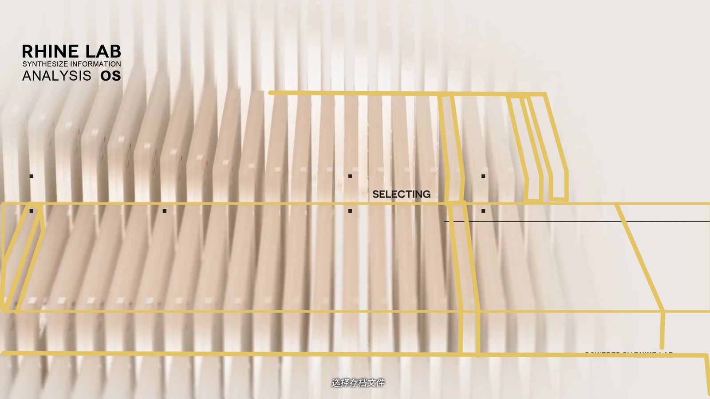
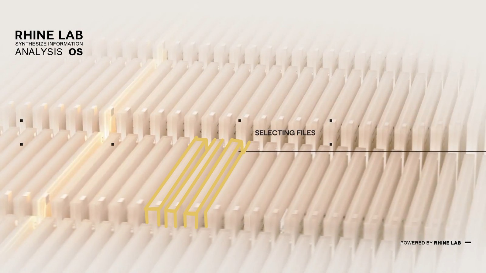
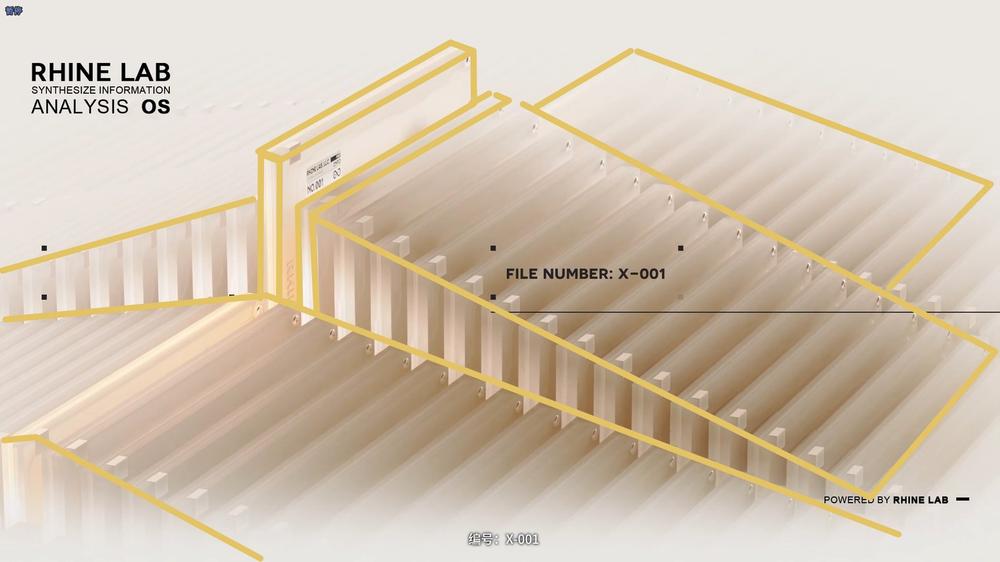

**这条在做什么：**
- 卡片多厚、缝多宽，我用文字说了两轮都不准。它的视觉识别没有那么精细，**那就把线画出来给它看**。
- 同一条里还纠正了一个运动上的误解：档案被抽出来的时候，**档案本身只是往上升，往前走的是镜头**。
- 这两点后来都被 Codex 写进了项目的 `AGENTS.md`，成了之后每次修改都要遵守的规则（见第 5 节）。

#### #7 · 00:49 · 设计交互

> 我感觉在交互模式下，左右选择时，它应该停在这个地方，也就是卡片还没完全升起来的时候。进入之后，卡片升起来，相机移动把卡片放到左边，右边展示信息，大概是这样一个操作方式。
>
> 另外我在想，在交互模式里左右移动时，卡片是从低精度状态变成高精度状态，下降回去之后又会变回低精度状态。中途这个卡片的变换其实有点突兀，能不能做一些相关的过渡？

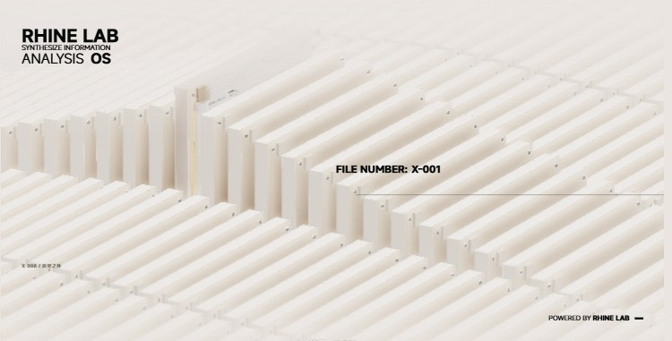

**Codex 做了什么（01:02 交付 v3）：** 左右选择时卡片停在浅抬起位置；确认后继续升起，镜头把它移到左侧，右侧信息渐显；切换时材质和内部细节连续过渡。

**这条在做什么：** 原片只是一段 PV，没有"交互"。**要变成能用的系统，交互需要人来设计。** 我截了原片里卡片半抬起的那一刻，告诉它"选择时停在这里"。

#### #8 · 01:15 · 报帧号，讲原理

> 所以整体效果已经比较符合我的预期了。我仔细看了一下，其实在这个760帧这里在这个地方，所有的波浪峰其实都是一样高的。当摄像机往右移时，相当于把 760 帧靠右边这一列移到了画面中间，它就充当了波浪更高的那一列。
>
> 其实别的列并没有完全变平，还是有一点起伏的，只是起伏程度没有中间这一列高，所以显得中间这一列是被选中的状态。
>
> 你可以看一下 760 帧到 785 帧左右的这几帧，大概就是我说的这个意思。副模式是不是可以加个上下键切换不同列啊？感觉这个交互也是比较有意思的。上下切换列的时候，过渡动画也可以设计一下这个卡片抬起来不够高，所以左右旋转的时候会穿模。另外，卡片收回去的时候，应该先旋转回刚才升起来的角度，然后再插回去，以避免穿模

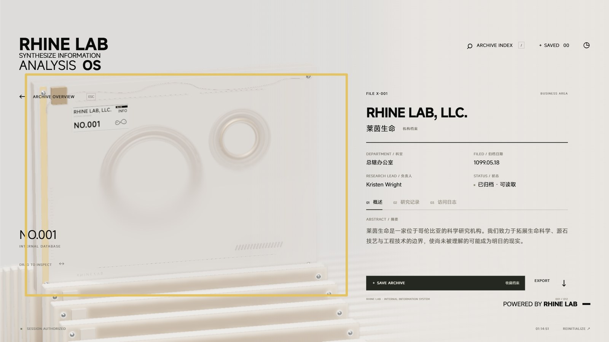

**这条在做什么：**
- **报帧号**：760 到 785 帧，它可以直接去看这一段，不用在整段视频里找。
- **讲原理**：波峰其实一样高，是镜头右移让中间那列看起来被选中了。只给帧号，它还是可能看错；加上我对原理的理解，它就不用猜了。
- 后半段是交互需求：上下键切列、抬高一点避免穿模、先转正再插回。

#### #9 · 01:30 · 调回来一点，换操作方式

> 我说，稍微抬起来，稍微高一点就行了。现在又太高了，导致看不到其他的卡片了，也觉得效果没有之前好 想是不是操作方式换一下：左右切换不同列，上下切换同一列的前后文档，好像这样操作起来更符合直觉。
>
> 另外，现在确实每一列都能到，但是每一列里面可以切换的卡片有点少。你可以再多参考一点相关世界观之类的，多写一点。我觉得每一列至少要有七八个卡片是可以看的吧。不然只有一两个，根本切换不了，也体现不出来这个动画效果。

**这条在做什么：**
- 它改过头了，就明确说"又太高了"，并说清楚为什么不好（"看不到其他的卡片"）。
- 给出更直觉的操作方式和具体数量（每列至少七八个）。

#### #10 · 01:41 · 小问题直接指出

> 这个标签这里怎么是个简笔画的logo？看你好像已经把logo提取出来了，直接复用就行了

**Codex 做了什么（01:53 交付 v4）：** 标签改为复用主界面同一份 Logo；左右切列、上下切档；每列 8 份，共 40 份档案；降低抬升高度；收回时先转正再下降；按 760–785 帧调整了镜头和波浪。

### 第三幕：从复刻到系统（#11–#22）

#### #11 · 01:58 · "大方向其实已经不用动"

> 模式转换到详情页的时候，大概有一两秒会是这种白色的状态，但是退出详情页的时候就不会有这种情况。你看是什么原因造成的，修复一下吧。
>
> 整体的效果其实我已经很满意了。这已经是非常细节的打磨了，大方向其实已经不用动。

**这条在做什么：** 这是全程最重要的几句话之一。**明确告诉它"大方向不用动了"**，等于冻结了方向。之后它只做细节修复，不会为了修一个小问题去重写整体。

#### #12 · 02:02 / #13 · 02:07 · 加一点呼吸感

> 在交付〔交互〕模式下，就算用户不操作，是不是也可以给整体卡片加一点呼吸感？也不要太剧烈

> 觉〔感觉〕这个呼吸的幅度好像有点太太小了，有点不太明显

**Codex 做了什么：** 停止操作约 2.5 秒后卡片缓慢、错落地起伏；我说太小，它调到 3 倍。详情页发白也修好了（雾效改为跟随相机的实际位置）。

**这条在做什么：** 给方向（不要太剧烈），看了效果再给一句具体的修正（太小了）。小的参数调整一两句话就够。

#### #14 · 02:11 · 报一个渲染错误

> 地方好像会有点渲染错误，不知道是这个模型重叠还是怎么回事，但是只会在特定的角度会看到

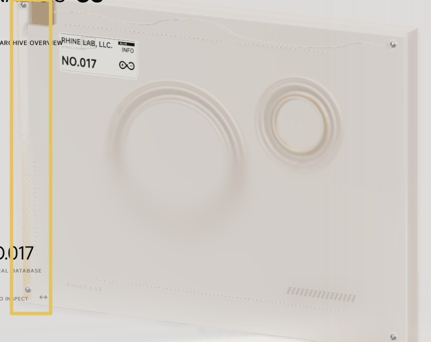

#### #15 · 02:12 · 先存基线

> 先保证你还没修改的这个版本是基线版本，然后再进行修改。我怕到时候你一改，现在效果也变差了

#### #16 · 02:14 · 建仓库

> 如果你还没有初始化 Git，可以先初始化一下，然后在我的 GitHub 上创建一个私有仓库，最后提交到该私有仓库里面

**Codex 做了什么（02:26 汇报）：**
- 基线：`ca57833`（02:16），打标签 `baseline-2026-09-08`，主分支保留原效果。
- 修复版：`69f9c99`（02:24），放在独立分支，只修正侧条的深度冲突，模型没改。

**这三条在做什么：** 发现一个 bug，**先不急着让它修**，而是先要求把现在满意的版本存成基线。怕的就是"一改，现在的效果也变差了"。修复放在分支上，确认没问题再合并。然后我去睡觉了。

#### #17 · 07:54 · 确认后合并

> 修复得挺好的，你把它合并到主分支吧

#### #18 · 07:57 · 加新功能

> 可不可以增加这样一个交互？在详情页加一个按钮，实现以下效果：
>
> 1. 360° 查看文档模型：支持使用上下左右键移动，使用鼠标滚轮放大缩小。
> 2. 一键查看拆解状态：在放大的页面加一个按钮，可以一键查看档案拆开之后的样子。
> 3. 一键重组：支持将档案一键重组。
>
> 我想象中大概是这么一个效果，你可以做出来试一下。

#### #19 · 08:10 · 回应确认

> 允许 修复吧

（回应 Codex 在做 #18 途中提出的确认。）

**Codex 做了什么（08:19）：** 详情页加了「360° 查看文档模型」：拖动旋转、方向键平移、滚轮缩放，一键拆成六组部件、一键重组，途中可以反向。放在独立分支 `feat/model-inspector`，主版本不动。

#### #20 · 08:21 · 光照统一

> 光照效果好像不如在外面，看一下能不能把它整体设计成和外面类似的状态

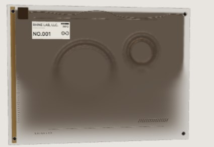 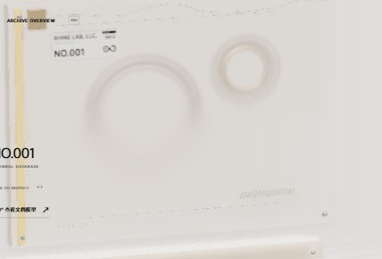

**Codex 做了什么：** 找到原因是查看器缺环境光，恢复了和外部详情页一致的浅色磨砂质感。

#### #21 · 08:28 / #22 · 08:29 · 不确定就让它先问

> 我在想，能不能用什么手段，把这个上下移动和左右移动做成一种类似于"伪无限"的感觉：永远不出现尽头，但是你可以一直往上、一直往下，一直往左、一直往右，到最后它就是一个循环的队列

Codex 没有直接开做，而是先问了一个问题：

> 你说的"伪无限循环队列"，是指哪一处？

我选了：

> 主界面的档案阵列：上下切档案、左右切列都能一直循环

**Codex 做了什么（08:47）：** 上下按每列八份循环，左右按五类循环，跨过首尾继续沿原方向移动，外围卡片自动补位；用固定数量的卡片循环复用，不会越用越占资源；做了两万次切换检查。

**这条在做什么：** 我的描述有歧义（主界面还是查看器？）。它**没有瞎猜，先反问**。不确定的时候，就让它先问，比做错了再改省得多。

### 第四幕：实验和回退（#23–#37）

这一段是我觉得最有意思的。

#### #23 · 08:51 · 以基线为准打磨

> 其实，现在整体效果已经很不错了，我觉得可以微调一下档案同一列前后移动时的起伏效果。我试了很多次，比如切换到下一个档案时，下一个档案出来前会先往下降，然后再出来，这个动画可能还可以再继续打磨一下。不过，我觉得可以以当前基线版本来进行打磨，因为现在的效果已经很不错了

#### #24 · 08:55 · 方案 A：只去掉负向波谷

> 减轻波浪之后，整体效果就没有机械版本好了。你试试，就是不减轻切换的波浪，但是单纯去掉它的负向波谷呢

**对应提交：** `2048536`

#### #25 · 08:59 · 看不出区别，做对比页

> 我感觉这个和基线版本没什么太大区别，能不能做个对比页面，看看两者的区别在哪

**这条在做什么：** 肉眼来回切换比不出区别的时候，**让它做一个同步对比页**：左右两边同时播放同一段动画。

#### #26 · 09:05 · 在对比页里提出假设（方案 B）

> 感觉这个项目〔Rolling Number〕用来增加项目的质感，应该还是比较有用的。
> 另外感觉我大概知道是什么问题了。能不能做成：选中档案升起来，之后再让波浪动画播放？这样感觉就像是因为下一个档案升起来，导致它波动了。
>
> 目前的问题好像是，波浪和选中档案的动画同时出现了。因为前一个档案还在比较高的地方，还没完全降下去，选中档案又升起来了；而此时选中档案还没升起来，导致前一个档案比选中档案还要高。

**这条在做什么：** 在对比页里，我看出了问题，就提了一个**有因果解释的假设**：先升起、再起波浪。顺便推荐了一个滚动数字的开源库。

#### #29 · 09:13 / #30 · 09:13 · 假设不成立

> 现在它会有一个跳起来再落下的效果。感觉这个效果是不是有点太突兀了？整体感觉不够丝滑

> 那就是那种选中之后不会升起的嘛，升起来之后，有一个很自然的涟漪的感觉

**Codex 做了什么（09:21）：** 改成"档案抬起一次，周围再泛起涟漪"，并把档案序号和列编号接入了 Rolling Number。**对应提交：** `a9534c8`

#### #31 · 09:22 · 回退（方案 C 同时开始）

> 还是基线版本吧，感觉还是基线版本的效果最好 接下来能不能继续打磨一下光影之类的效果？我感觉原视频的光影处理和现在还是有些差距。虽然现在整体效果我已经很满意了，你看还有没有什么打磨的空间吧

**Codex 做了什么（09:39）：** 恢复原始基线动效；另做了一轮光影微调，并做了可以切换"原视频 / 调整前"的光影对照页。**对应提交：** `65f07d9`

#### #32 · 09:40 · 光影也回退，数字加滚动

> 这里的数字是不是也可以用这个滚动数字的效果啊？感觉效果会不错 颜色还是整体基线版本的更好看一点，还是用基线版本的颜色吧

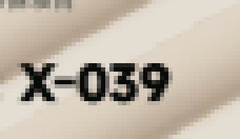

**这几条在做什么：** 三个方案：去掉负向波谷（看不出区别）、先抬起再起涟漪（跳一下反而不丝滑）、光影微调（还是原来的颜色好看），**试完都不如基线，就明确回退**。实验没有白做，它证明了基线是对的。Codex 后来把这个选择写进了 `AGENTS.md`："此前去波谷、先抬起后波浪及源点静止方案只保留为对照实验，不用于主界面。"

#### #33 · 09:46 · 描述一个具体的过渡

> 文字在快速变化的时候，是不是也可以增加一些过渡效果？比如，快速变化时闪烁之后变成一个长条的黑块，等它静止之后，再闪烁恢复成原来的字体。感觉这样会比文字频繁切换的效果好一些

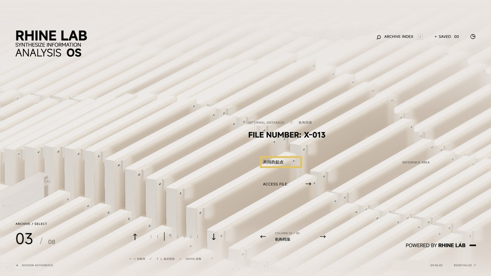

#### #34 · 09:47 · 进出过渡

> 进入 360° 观看档案的效果时，是不是也可以加一些过渡？也就是进入和退出这个页面的时候

**Codex 做了什么（10:03）：** 标题快切时闪动变黑条、停下后恢复；360° 查看页淡入展开、淡出收拢；颜色恢复基线；档案编号保留滚动效果。

#### #36 · 10:03 · 逐帧打磨 2D 开场

> 整体的 3D 交互，我觉得你把这项任务做完，基本上差不多了。
>
> 但是整个视频前面有一部分 2D 的交互，包括英文字母的出现，以及前面 2D 的过渡和转场，我觉得其实还可以打磨一下。你按照原片每一帧看一下，它到底是怎么样的动效节奏，好好看一下，把前面那一段 2D 的部分再打磨一下。

#### #37 · 10:17 · 说清楚不做什么

> 我忘记和你说了 这个黑色背景的 鹰角网络这个不用做 从画面变白开始做就行

**Codex 做了什么（10:31）：** 从白场后的英文输入开始打磨，跳过黑底片头：调整了逐字输入和停顿、标志绘制和移位、圆环收拢、欢迎页闪切、黑底扫字和白场转场，并做了原片逐帧对照页。

**这条在做什么：** **说清楚哪些不做，其实也是需求。** 不说的话，它会认真地把片头也复刻一遍。

### 第五幕：交付（#27、#28、#35、#38）

这几条是在**另一个窗口**里说的，专门做演示视频和投稿，和开发主线程并行。

#### #27 · 09:08 · 开一个窗口专门做演示视频

> 我想把这个作为一个演示视频发到 B 站去。你帮我把这个视频做一下，大概的视频节奏如下：
>
> 1. 一开始先展示原画面和这个画面的对比。
> 2. 展示完对比后，再展示我们后面的交互操作。比如切换无线〔无限〕列表、展开详情页等，你把这些操作都录下来。
>
> 最后，把这些内容整合做成一个完整的视频。

#### #28 · 09:11 · 回答 Codex 的提问

Codex 问："视频声音有什么偏好？我建议用轻量环境音乐搭配操作提示音，不加口播。"我选了"环境音乐＋操作提示音"。

#### #35 · 09:47 · 发现录的是旧版本

> 看了一下，你这个对比视频好像是老版本的。因为现在另外一个聊天窗口还在工作，你等它工作完了之后，刷新页面重新录一个。
>
> 另外，因为也添加了其他不同的效果，你可以看一下另外一个聊天窗口。整体上，把输出视频的分辨率调成 4K，帧率用 60 帧。

**Codex 做了什么（10:52）：** 等开发窗口做完，刷新后重新录制，输出 4K 60 帧、2 分 05 秒的演示视频，包含新版开场、无限循环、编号滚动、360° 旋转和拆解重组。

**这条在做什么：** 两个窗口并行时，要注意它们看到的是不是同一个版本。

#### #38 · 11:19 · 投稿和开源

> 你打开我浏览器 edge 然后打开b站 右上角 投稿 上传一下视频 然后写一下标题 【开源】眩晕瘫坐！GPT-6 Astra代码复刻莱茵生命PV
> 再做个封面 左边是原本 右边是做出来的 选一张效果比较好的图 原版那边写个 原版 右边写个Astra 然后整理一下文件 把我的这个仓库设为公开 并把原项目打包后〔上传网盘并分享〕 获得分享链接 在简介中写上相关信息和仓库链接还有项目下载链接 完成这些就行 不用发布

（原话里的网盘路径和分享信息已删掉。）

**结果：** Codex 整理文件、公开仓库，在 11:33 提交了 `df7da0f`，也就是本文说的"第一版"。B 站只存了草稿，最后由我自己发布。

---

## 5. 反馈怎么沉淀成规则

Codex 在项目根目录维护了一份 `AGENTS.md`，每次开工前都会读。我的反馈里有长期有效的，它会写进去，之后每次修改都要遵守。下面是 `df7da0f` 里「标注修订约束」一节的原文：

> - 用户标注对应原片约 27.60、29.16、31.56 秒；相机校准同时检查端面厚度、空隙和前后排边界。
> - 同一档案从阵列升起并进入特写时，仅允许竖直升降，不能把模型向前或横向平移来重新构图；靠近与转向由摄像机完成。初始整组阵列入场及切换档案的轨道移动不属于抽取动作。
> - 背景卡片不能随特写进度额外下沉来让出画面。
> - 交互模式左右切换五类档案列，上下切换同一列的前后档案；每列至少 8 份可读档案。切列保留该列的选择记忆。
> - 预览时卡片抬起 0.4；交互详情升至 4.05（原片时间轴仍为 3.35），只比早先略高，必须保留后方阵列的可见层次。镜头负责左侧构图，右侧展示信息。
> - 卡片获得净空后才允许拖拽旋转；收回时保持高度先转正，再下降。被换选的旧卡片也遵守此顺序。
> - 阵列与抽出卡片的材质、内部细节必须连续过渡，快速切回正在归位的卡片时保留当前升降状态。
> - 标签复用主界面的同一份莱茵生命标志，不使用另画的简笔版本。

对照前面的消息：第 2 条来自 #6，第 4 条来自 #9，第 5 条来自 #7 和 #9，第 6 条来自 #8，第 7 条来自 #7，第 8 条来自 #10。

**一次反馈，就这样变成了一条长期的约束。** 上下文被压缩了 8 次，这些规则没有丢。

同一份文件里还记着"当前动效选择"：

> 用户试用后明确选择原始基线 aeddd8f：选中抬起和波浪同时开始，恢复原有负向波谷与 4.2 阻尼速率。此前去波谷、先抬起后波浪及源点静止方案只保留为对照实验，不用于主界面。

回退也被记下来了，这样之后不会有人"好心"把实验方案又改回去。

---

## 6. 第二天的复盘：观察和解释

第二天（09-09）我问 Codex：

> 我的这种方向引导，比如我给你标一些线之类的，如果让你自己去做，你会不会有什么实现方法来实现这种效果……其实可以通过一些画面的引导，让你更好地去识别并复刻

它的回答里有一段我特别认同，原文如下：

> 这里最需要区分的是：**画面中测到的现象，以及我对原因的推测。** 比如"这条边在画面里下降了"是观察；"卡片向下移动了"只是一个解释，也可能是相机变化。此前一些反复修改，就发生在这一步没有分清。

回头看，大部分返工都卡在这一步：

| 观察（画面里测到的） | 可能的解释 | 这次的真相 |
|---|---|---|
| 列数不对 | 间距不对？镜头不对？ | 镜头焦段不对（#5） |
| 卡片在画面里前移 | 卡片在动？镜头在动？ | 镜头在动，卡片只是升起（#6） |
| 中间那列波峰最高 | 中间那列被单独抬高？镜头移动造成的？ | 波峰一样高，是镜头右移（#8） |

它还给了一套自己能做的流程，我觉得可以直接拿来用：

1. **先做自己的标注图**：在参考画面上标中心线、边界、圆心、遮挡关系、文字基线，再换算成测量值。
2. **把复杂画面拆成局部证据**：整体构图和局部放大都要看；动效按开始、加速、减速、停止分段比较。
3. **用多帧检验同一个解释**：同一套模型和相机参数，要能同时解释多个角度、多个时间点。
4. **把渲染结果叠回参考图**：用半透明叠合、轮廓对照、连续帧残影找偏差，一次只调对应的那个参数。

我接着让它不看我当时的标注图，自己去标卡片的厚度和间距。它能标出来，但选的区域不够好；我指了一个"顶角完整、两侧边界能追踪、邻片关系清楚"的区域，它才标得更准。它最后的结论是：

> 如果当时先有一张边界判断准确的标注图，实现通常会更快，比例也更容易做对……需要你参与的地方，应当逐渐集中到"哪种解释符合你的意图"和"哪项差异更重要"。

---

## 7. 可以直接套用的反馈句式

下面是从这 38 条里提炼的句式，换成你自己的项目内容就能用。

**第一条提示词**

```text
参考 [参考物] 的 [具体范围]，做一个 [目标]。
验收标准：[能对着参考检查的标准，例如"逐帧对齐""误差不超过 X"]。
必须：[硬约束]。
不要：[排除项]，因为 [理由]。
技术路线你自己选。
参考里没有展示的部分，你按同样的品质自己补。
```

**说现象，不开方子**

```text
和参考比，[哪里] 不对：参考里是 [现象]，你这里是 [现象]。
你可以逐帧看一下 [时间段]，自己判断差在哪。
```

**给它能自己验证的方法**

```text
参考里 [某处] 能数出几个 [单位]？你现在是几个？自己对比一下。
```

**纠正归因**

```text
这不是 [它以为的原因] 的问题，是 [真正的原因] 的问题。
先把 [它为错误原因做的改动] 撤回，再调 [正确的地方]。
```

**看不清就画、报帧号、讲原理**

```text
我在截图上把 [边界/厚度/间距] 标出来了，按标注核对一下。
看 [第 X 到 Y 帧]：[现象]。我的理解是 [原理]，所以 [看起来的效果]。
```

**冻结方向，先存基线**

```text
整体效果我已经满意了，大方向不用动。
改之前，先把现在这版存成基线；修复放在单独的分支上，我确认后再合并。
```

**做对比、敢回退**

```text
我看不出和基线的区别，做一个同步对比页，左右同时播放同一段。
（试完之后）还是基线吧，把实验方案保留成对照，不用于主版本。
```

**说清楚不做什么**

```text
[某部分] 不用做，从 [某处] 开始就行。
```

---

## 8. 踩过的坑

- **改对了症状、改错了原因**（#5）：列数凑对了，透视还是错的。它给出一个"修好了"的结果时，要确认它是用什么方法修的。
- **改过头**（#9）：说"抬高一点"，结果抬得太高，把后面的卡片都挡住了。调整量最好说清楚参照物（"能看到后面的卡片"）。
- **实验方案悄悄混进主版本**：所以每次实验都放在单独的提交或分支上，回退时让它写进规则文件。
- **两个窗口版本不一致**（#35）：录视频的窗口录到了旧版本。并行时要说清楚"等另一个窗口做完再做"。
- **找不到答案的问题**：字体到最后也没找到原片用的是哪一款（这是 `df7da0f` 之后的事）。试过自己重建字形，效果不如直接用 MiSans，就停了。给兜底方案、及时止损，也是流程的一部分。

---

## 9. 附录

### A. 38 条消息总表

| # | 时间 | 窗口 | 附图 | 内容 |
|---|---|---|---|---|
| 1 | 09-07 21:48 | 开发 | | 第一条提示词：像素级复刻，参考 5–40 秒 |
| 2 | 22:50 | 开发 | | 和视频是一个东西吗？完全不是一个级别；波纹、材质 |
| 3 | 23:44 | 开发 | | 五条清单：字体、摄像机、余波、间距、光照 |
| 4 | 23:47 | 开发 | | 白色界面到卡片界面的过渡没做出来 |
| 5 | 09-08 00:02 | 开发 | | 不是间距的问题，是摄像机的问题 |
| 6 | 00:35 | 开发 | 3 | 标注厚度和间隔；档案只上升，镜头在移动 |
| 7 | 00:49 | 开发 | 1 | 交互模式：半抬起、确认后推到左侧；精度过渡 |
| 8 | 01:15 | 开发 | 1 | 760 帧波峰一样高；上下切列；先转正再插回 |
| 9 | 01:30 | 开发 | | 抬太高了；左右切列上下切档；每列七八个 |
| 10 | 01:41 | 开发 | 1 | 标签 Logo 直接复用 |
| 11 | 01:58 | 开发 | 2 | 详情页发白；大方向已经不用动 |
| 12 | 02:02 | 开发 | | 加一点呼吸感 |
| 13 | 02:07 | 开发 | | 呼吸幅度太小 |
| 14 | 02:11 | 开发 | 1 | 特定角度渲染错误 |
| 15 | 02:12 | 开发 | | 先保证当前版本是基线 |
| 16 | 02:14 | 开发 | | 初始化 Git，建私有仓库 |
| 17 | 07:54 | 开发 | | 修复得挺好，合并到主分支 |
| 18 | 07:57 | 开发 | | 360° 查看、拆解、重组 |
| 19 | 08:10 | 开发 | | 允许，修复吧 |
| 20 | 08:21 | 开发 | 2 | 查看器光照和外面统一 |
| 21 | 08:28 | 开发 | | 伪无限循环队列 |
| 22 | 08:29 | 开发 | | 回答 Codex：主界面阵列上下左右都循环 |
| 23 | 08:51 | 开发 | | 同列切档的起伏再打磨，以基线为准 |
| 24 | 08:55 | 开发 | | 不减轻波浪，只去掉负向波谷 |
| 25 | 08:59 | 开发 | | 和基线没区别，做个对比页面 |
| 26 | 09:05 | 开发 | | Rolling Number；假设：先升起再起波浪 |
| 27 | 09:08 | 视频 | | 做成演示视频发 B 站 |
| 28 | 09:11 | 视频 | | 回答 Codex：环境音乐加操作提示音 |
| 29 | 09:13 | 开发 | | 跳起来再落下，不够丝滑 |
| 30 | 09:13 | 开发 | | 升起来之后自然的涟漪 |
| 31 | 09:22 | 开发 | | 还是基线版本吧；打磨光影 |
| 32 | 09:40 | 开发 | 1 | 数字滚动；颜色用回基线 |
| 33 | 09:46 | 开发 | 1 | 文字快速变化时变黑条 |
| 34 | 09:47 | 开发 | | 360° 查看的进出过渡 |
| 35 | 09:47 | 视频 | | 录的是老版本，等另一个窗口做完重录 4K60 |
| 36 | 10:03 | 开发 | | 逐帧打磨前段 2D 动效 |
| 37 | 10:17 | 开发 | | 黑底鹰角片头不用做 |
| 38 | 11:19 | 视频 | | B 站投稿、封面、仓库公开，不用发布 |

### B. 关键提交

以下提交都在公开仓库里，可以检出后自己对比。

| 提交 | 时间 | 说明 |
|---|---|---|
| `ca57833` | 09-08 02:16 | 基线，标签 `baseline-2026-09-08`（#15、#16） |
| `69f9c99` | 09-08 02:24 | 侧条深度冲突修复，07:55 合并（#14、#17） |
| `aeddd8f` | 09-08 08:45 | 循环阵列（#21、#22），也是第四幕实验对照的基线 |
| `2048536` | 09-08 08:57 | 实验 A：去掉负向波谷（#24） |
| `a9534c8` | 09-08 09:20 | 实验 B：先抬起，再起涟漪（#26、#29、#30） |
| `65f07d9` | 09-08 09:37 | 恢复基线动效，并做实验 C：光影微调（#31） |
| `df7da0f` | 09-08 11:33 | 开源整理版，也就是本文的"第一版"（#38） |

v0–v4 早于 Git 初始化，只留下了 Codex 当时自检用的截图（见第 2 节的图）。

### C. 数据口径和脱敏说明

- 时间来自 Codex 本地会话记录，换算为北京时间。
- 消息数：两段开发会话加一段录视频会话里的用户消息，去掉一条被中断后原样重发的重复消息，一共 38 条。
- Token 和费用来自当时的用量记录，按 API 标准价折算，不等于实际订阅账单。
- 脱敏：删掉了本机路径、本地预览地址、网盘分享链接、投稿草稿信息、浏览器状态信息；截图里的账户姓名、播放器播放列表已遮挡或裁掉。原话的其他部分没有改动。
- 原片画面版权归鹰角网络所有，本文仅作学习交流中的对照引用。
